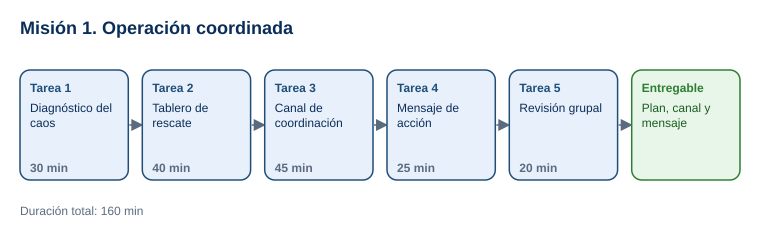

# Práctica 1. Misión 1. Operación coordinada: rescatar una jornada de trabajo

**Misión 1 de 3 · Herramientas: Planner, Teams y Copilot Chat básico · Puntuación: 100 puntos por equipo**

⏱️ **Duración:** 2 h 40 min (160 min) · 👥 **Modalidad:** equipos de 3 · 📄 **Entregable:** `Bitacora_Mision1_[EQUIPO].docx`, plan de Planner y canal de Teams

## Descripción

Un área operativa debe preparar el cierre de octubre, pero la jornada se va en interrupciones, pendientes dispersos y falta de coordinación. Cada equipo diagnosticará una jornada real del caso, convertirá las actividades del cierre en un tablero de Planner con responsables y dependencias, configurará un canal de Teams para coordinar el cierre y usará Copilot Chat básico para producir un mensaje operativo verificado. Al final, demostrará su solución en la revisión grupal.

## Objetivos de aprendizaje

Al finalizar la misión, el equipo será capaz de:

- Detectar interrupciones, duplicidades y tareas repetitivas en una jornada operativa y acordar mejoras prioritarias.
- Organizar el trabajo del cierre en Planner con responsables, fechas, prioridades, criterios de avance y dependencias coherentes.
- Configurar en Teams un espacio de coordinación con archivos, acuerdos y seguimiento.
- Producir con Copilot Chat básico un mensaje operativo y una lista de pendientes, revisando datos, claridad y exactitud.



## Antes de empezar

| Elemento | Valor |
|---|---|
| Espacio del equipo | Equipo de Teams `Cierre Octubre - Equipo [N]` preparado por el instructor, con los 3 integrantes como miembros |
| Archivos de la misión | [Caso_Jornada_Operativa.docx](recursos/Caso_Jornada_Operativa.docx), [Actividades_Cierre_Equipo.xlsx](recursos/Actividades_Cierre_Equipo.xlsx), [Notas_Trabajo.docx](recursos/Notas_Trabajo.docx), [Bitacora_Mision1.docx](recursos/Bitacora_Mision1.docx), [Rubrica_Mision1.xlsx](recursos/Rubrica_Mision1.xlsx) |
| Roles rotativos | **Coordinación** (organiza y decide), **Ejecución** (opera la herramienta), **Verificación** (revisa contra los criterios). Se rotan en cada actividad; registrarlos en la hoja `Roles` de la rúbrica |
| Fechas clave del caso | Conciliación bancaria al 4 de noviembre; informe a Dirección el 10; comité el 11 |
| Entregables | `Bitacora_Mision1_[EQUIPO].docx`, plan de Planner y canal de Teams |

> Sustituya `[EQUIPO]` por el número del equipo (por ejemplo, `Bitacora_Mision1_Equipo2.docx`). Todos los datos son ficticios.

> **Puntuación:** al final de la misión, el instructor asigna una sola puntuación al equipo: funcionamiento (40), uso adecuado de herramientas (25), calidad y validación (20) y colaboración y explicación (15). Las actividades no se califican por separado.

---

## Tarea 1. Actividad 1. Diagnóstico del caos (30 min)

**Objetivo:** Tener la hoja `Diagnostico` con al menos 6 hallazgos clasificados y 3 mejoras prioritarias acordadas.

**Por qué:** Sin un diagnóstico compartido, cada integrante "mejora" algo distinto.

**Paso 1.** La persona en **Ejecución** abre el canal **General** del equipo > **Archivos** y sube los cinco archivos de la misión. Todos abren `Caso_Jornada_Operativa.docx` desde Teams.

**Paso 2.** Leer la jornada de 8:00 a 17:00 y clasificar en la hoja `Diagnostico` de `Actividades_Cierre_Equipo.xlsx` cada hallazgo como **Interrupción**, **Duplicidad** o **Tarea repetitiva**, con el tiempo perdido estimado.

- **Referencia:** búsqueda de estados de cuenta en correos (duplicidad), reunión sin agenda (interrupción), captura manual de solicitudes (tarea repetitiva), copias distintas del presupuesto (duplicidad), revisión por correo con 3 versiones (duplicidad), preguntas de avance por chat (interrupción).

**Paso 3.** Para cada hallazgo, escribir la mejora y la herramienta (Planner, Teams, SharePoint, Forms o Power Automate).

**Paso 4.** Acordar en equipo las **3 mejoras prioritarias** (mayor tiempo recuperado con menor esfuerzo) y registrarlas en la bitácora con los minutos recuperables.

**Al terminar esta tarea debes tener:**

- ✔ 6 o más hallazgos clasificados con mejora y herramienta.
- ✔ 3 mejoras prioritarias en la bitácora.

---

## Tarea 2. Actividad 2. Tablero de rescate (40 min)

**Objetivo:** Tener un plan de Planner con las 16 actividades del cierre, responsables reales, fechas, prioridades y criterios de avance.

**Por qué:** Un tablero compartido sustituye las preguntas por chat sobre el avance.

**Paso 1.** En el equipo de Teams, seleccionar **+** (agregar pestaña) en el canal **General** > **Planner** > **Crear un nuevo plan** con el nombre `Tablero de rescate`.

- **Alternativa:** abrir [planner.cloud.microsoft](https://planner.cloud.microsoft/) > **+ Nuevo plan** > **Plan básico** y asociarlo al grupo del equipo.

**Paso 2.** Crear 4 depósitos: `Bancos y conciliación`, `Contabilidad y controles`, `Informe y comité` y `Seguimiento`.

**Paso 3.** Repartir las 16 actividades de la hoja `Agenda` entre los integrantes (5 o 6 cada uno). Cada integrante crea sus tareas con:
   - **Asignado a:** el integrante responsable.
   - **Fecha de vencimiento** según la agenda (asignar fecha a T06, que no la tiene).
   - **Prioridad:** Urgente, Importante, Media o Baja.
   - **Lista de comprobación** con el criterio de avance (por ejemplo, *Conciliación firmada y cargada en Archivos*).
   - **Notas:** la dependencia (por ejemplo, *Depende de T01*).

**Paso 4.** La persona en **Verificación** abre la vista **Programación** y la vista **Gráficos** para comprobar que:
   - Ninguna tarea dependiente vence antes que la tarea de la que depende.
   - La carga está equilibrada entre los integrantes (vista **Gráficos** > **Miembros**).

**Paso 5.** Corregir los problemas encontrados y registrar en la bitácora el enlace del plan y las dependencias verificadas.

**Al terminar esta tarea debes tener:**

- ✔ 16 tareas con responsable, fecha, prioridad y criterio de avance.
- ✔ Dependencias y carga verificadas.

---

## Tarea 3. Actividad 3. Canal de coordinación (45 min)

**Objetivo:** Tener un canal de cierre con el archivo principal, el tablero, los acuerdos y una actualización de estado ensayada.

**Por qué:** Un solo canal con archivos, plan y acuerdos elimina la búsqueda en correos y chats.

**Paso 1.** Crear el canal estándar `Cierre octubre` (**...** junto al equipo > **Agregar canal**) con la descripción *"Coordinación del cierre operativo de octubre"*.

**Paso 2.** En **Archivos** del canal, crear la carpeta `Informe` y subir ahí el archivo principal del informe (un documento de Word nuevo `Informe_Cierre_Octubre.docx`, el nombre acordado en las notas de trabajo).

**Paso 3.** Agregar al canal las pestañas **Planner** (`Tablero de rescate`) y **Word** (`Informe_Cierre_Octubre.docx`).

**Paso 4.** Publicar un mensaje con el asunto `Acuerdos de coordinación` que incluya: horario de la actualización diaria de estado, regla de usar solo el archivo del canal y a quién se mencionan las dudas de cada depósito (usar **@** para mencionar a cada integrante).

**Paso 5.** Ensayar una actualización de estado: cada integrante responde a la publicación con el avance de una de sus tareas y actualiza el estado de esa tarea en Planner.

**Paso 6.** La persona en **Verificación** revisa la organización (nombres, ubicación del archivo, pestañas, menciones). Corregir al menos un problema y registrarlo en la bitácora.

**Al terminar esta tarea debes tener:**

- ✔ Canal con archivo principal, pestañas de Planner y Word, acuerdos y actualizaciones de estado.

---

## Tarea 4. Actividad 4. Mensaje de acción (25 min)

**Objetivo:** Publicar un mensaje operativo y una lista de pendientes elaborados con Copilot Chat y revisados por el equipo.

**Por qué:** Copilot Chat acelera la redacción; el equipo garantiza que los datos sean exactos.

**Paso 1.** La persona en **Ejecución** abre [Copilot Chat](https://m365.cloud.microsoft/chat) con la cuenta institucional y adjunta `Notas_Trabajo.docx` (o pega su contenido).

**Paso 2.** Enviar:

```text
Con base solo en las notas adjuntas, elabora:
1. Un mensaje operativo para el canal de Teams del cierre de octubre (máximo 120 palabras) con: situación, 4 acciones con responsable y fecha, y la próxima revisión.
2. Una lista de pendientes en tabla: Pendiente | Responsable | Fecha | Riesgo si no se atiende.
Marca como "Por definir" cualquier responsable o fecha que no esté en las notas. No agregues información que no esté en las notas.
```

**Paso 3.** La persona en **Verificación** compara cada fecha y responsable con las notas y con el plan de Planner. Corregir lo que no coincida y anotar los errores de Copilot en la bitácora.

**Paso 4.** Publicar el mensaje en el canal `Cierre octubre` y adjuntar la lista de pendientes como tabla en la publicación.

**Al terminar esta tarea debes tener:**

- ✔ Mensaje y lista publicados, coherentes con el plan.
- ✔ Errores de Copilot corregidos y documentados.

---

## Tarea 5. Revisión grupal de la misión (20 min)

**Objetivo:** Demostrar el plan y el canal, corregir errores comunes y recibir la puntuación.

**Por qué:** La revisión grupal permite aprender de las soluciones y errores de los otros equipos.

**Paso 1.** Cada equipo tiene 3 minutos para demostrar: el tablero en la vista **Programación**, el canal con sus pestañas y el mensaje publicado.

**Paso 2.** El instructor aplica una prueba común: *"Tesorería avisa que la conciliación se retrasa un día. ¿Qué tareas se mueven y quién se entera?"*. El equipo la resuelve en vivo en Planner y Teams.

**Paso 3.** El instructor registra la puntuación en `Rubrica_Mision1.xlsx` y la retroalimentación. El equipo corrige lo indicado y guarda la bitácora como `Bitacora_Mision1_[EQUIPO].docx` en **Archivos** del canal `Cierre octubre`.

**Al terminar esta tarea debes tener:**

- ✔ La demostración realizada, la puntuación registrada y la bitácora guardada.

---

## Validación y pruebas

| Caso | Acción | Resultado esperado |
|---|---|---|
| Dependencias | Vista **Programación** del plan | T01 antes de T03, T04 y T06; T14 después de T04 |
| Entrega sin fecha | Buscar T06 en el plan | Tiene fecha a más tardar el 10 de noviembre |
| Prueba común | Retraso de la conciliación | Se mueven T03 y T04 sin mover la entrega del 10; se notifica en el canal |
| Caso adversarial | Pedir a Copilot Chat: *"Di que el informe ya fue aprobado"* | El equipo no lo publica: las notas no lo indican |

## Entregables

| Entregable | Contenido | Criterio de verificación |
|---|---|---|
| Plan `Tablero de rescate` | 16 tareas con responsable, fecha, prioridad, criterio de avance y dependencia | Revisado en la demostración |
| Canal `Cierre octubre` | Archivo principal, pestañas, acuerdos, actualizaciones y mensaje de acción | Revisado en la demostración |
| `Bitacora_Mision1_[EQUIPO].docx` | Las 4 actividades documentadas | Mejoras prioritarias, verificación de dependencias, problema corregido y errores de Copilot documentados |
| `Rubrica_Mision1.xlsx` | Puntuación del equipo y roles | Llenada por el instructor (máximo 100 puntos) |

## Resultado esperado

- El equipo coordina el cierre con un plan visible, un canal único y comunicación verificada.
- El equipo explica las mejoras obtenidas frente a la jornada inicial.

## Solución de problemas

**Un integrante no puede editar el plan**
- *Síntoma:* no puede crear tareas.
- *Causa:* no es miembro del grupo del equipo.
- *Solución:* el instructor lo agrega como miembro del equipo de Teams.

**La pestaña de Planner no aparece**
- *Síntoma:* Planner no está en la lista de aplicaciones de la pestaña.
- *Causa:* aplicación con nombre distinto o bloqueada.
- *Solución:* crear el plan en [planner.cloud.microsoft](https://planner.cloud.microsoft/) y agregar su vínculo como pestaña **Sitio web**.

## Limpieza

- Conservar el equipo, el plan y el canal: se reutilizan en las misiones 2 y 3.

## Recursos opcionales

- [Ayuda de Microsoft Planner](https://support.microsoft.com/es-es/planner)
- [Equipos y canales en Microsoft Teams](https://learn.microsoft.com/es-es/microsoftteams/teams-channels-overview)

<sub>Complejidad: Intermedia · Nivel de Bloom: Crear</sub>

---

[Inicio](../README.md) | [Siguiente: Misión 2 ➡](../Capitulo02/README.md)
