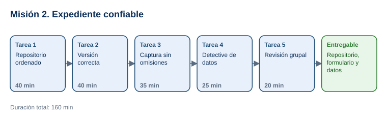

# Práctica 2. Misión 2. Expediente confiable: información sin pérdidas

**Misión 2 de 3 · Herramientas: SharePoint, Forms y Excel · Puntuación: 100 puntos por equipo**

⏱️ **Duración:** 2 h 40 min (160 min) · 👥 **Modalidad:** equipos de 3 · 📄 **Entregable:** `Bitacora_Mision2_[EQUIPO].docx`, biblioteca `Expediente Cierre`, formulario `Solicitudes del cierre - Equipo [N]` y `Respuestas_Depuradas_[EQUIPO].xlsx`

## Descripción

El mismo cierre de octubre de Servicios Integrales del Centro (SIC) tiene dos problemas. Hay 4 archivos del informe con nombres como "final" y "final_FINAL", y nadie sabe cuál es el vigente. Además, las solicitudes de pago llegan por correo sin factura, sin fecha o duplicadas. Su equipo creará en SharePoint un expediente ordenado con nomenclatura, metadatos, vistas y versiones. También diseñará en Forms un formulario que impida solicitudes incompletas y depurará en Excel las respuestas de prueba para dejarlas listas para análisis en Excel o Power BI.

## Objetivos de aprendizaje

Al finalizar la misión, el equipo será capaz de:

- Crear una biblioteca de SharePoint con estructura, nomenclatura, metadatos, vistas y responsables.
- Verificar la trazabilidad de un documento con el historial de versiones y revisar el acceso básico.
- Diseñar un formulario de Forms con campos obligatorios y restricciones, y probarlo con respuestas completas e incompletas.
- Identificar vacíos, formatos inconsistentes y duplicados en las respuestas y organizarlas en una tabla de Excel.

## Antes de empezar

| Elemento | Valor |
|---|---|
| Espacio del equipo | Equipo de Teams `Cierre Octubre - Equipo [N]`, su canal `Cierre octubre` (Misión 1) y su sitio de SharePoint |
| Archivos de la misión | [Archivos_Muestra_Cierre.zip](recursos/Archivos_Muestra_Cierre.zip), [Campos_y_Solicitudes.xlsx](recursos/Campos_y_Solicitudes.xlsx), [Respuestas_Prueba_Forms.xlsx](recursos/Respuestas_Prueba_Forms.xlsx), [Bitacora_Mision2.docx](recursos/Bitacora_Mision2.docx), [Rubrica_Mision2.xlsx](recursos/Rubrica_Mision2.xlsx) |
| Dato clave | El estado real de cada documento está escrito **dentro** del archivo, no en su nombre |
| Reparto de áreas | Igual que en la Misión 1: **A** Tesorería y Planeación · **B** Contabilidad y Compras · **C** Coordinación y Recursos Humanos |
| Entregables | `Bitacora_Mision2_[EQUIPO].docx`, biblioteca `Expediente Cierre`, formulario `Solicitudes del cierre - Equipo [N]` y `Respuestas_Depuradas_[EQUIPO].xlsx` |

> Los roles (Coordinación, Ejecución y Verificación) se rotan en cada actividad y se registran en la hoja `Roles` de `Rubrica_Mision2.xlsx`, igual que en la Misión 1. Todos los datos son ficticios.

**Preparación (2 min).** En el canal **General**, seleccionar **Archivos** > **Cargar** > **Archivos** y cargar `Campos_y_Solicitudes.xlsx`, `Respuestas_Prueba_Forms.xlsx`, `Bitacora_Mision2.docx` y `Rubrica_Mision2.xlsx`. Descargar `Archivos_Muestra_Cierre.zip` en su equipo; no se carga en Teams.

---

## Tarea 1. Actividad 1. Repositorio ordenado (40 min)

**Objetivo:** Tener la biblioteca `Expediente Cierre` con los 4 documentos vigentes del cierre, renombrados con la nomenclatura acordada, y las reglas de estructura, nomenclatura y responsables escritas en la bitácora.

**Por qué:** El ZIP tiene 9 archivos, pero solo 4 sirven para el cierre de octubre. Si todos se cargan tal cual, el problema de "¿cuál es el bueno?" solo cambia de lugar.

**Paso 1.** Rotar los roles y registrarlos en la hoja `Roles` (Actividad 1).

**Paso 2.** En el Explorador de archivos, hacer clic derecho en `Archivos_Muestra_Cierre.zip` > **Extraer todo** > **Extraer**. Abrir cada uno de los 9 archivos y llenar en la bitácora, sección **Actividad 1**, una tabla con estas columnas (agregarla debajo de la tabla existente):

| Archivo | Estado escrito en el contenido | Fecha | ¿Se conserva? | Nombre nuevo |
|---|---|---|---|---|
| `Informe_Cierre_Oct_final_FINAL.docx` | APROBADO por Dirección | 2026-11-09 | Sí | `2026-10_Informe_Cierre.docx` |
| ... | ... | ... | ... | ... |

- **Importante:** se conserva **un solo archivo por documento**: el vigente. Los borradores, las copias y los documentos de otro periodo no se cargan; SharePoint guardará las versiones nuevas en su historial.
- **Qué verás:** 4 archivos para conservar (informe, conciliación, presupuesto y soportes de pagos) y 5 para descartar.

**Paso 3.** Acordar y escribir en la bitácora (filas *Estructura y nomenclatura acordadas* y *Responsables*):

- **Estructura:** una sola biblioteca con columnas de metadatos; sin carpetas por persona ni por versión.
- **Nomenclatura:** `AAAA-MM_Tipo_Descripcion.ext`, sin espacios, sin acentos y sin palabras como `final`, `copia` o `v2` (la versión la lleva SharePoint).
- **Responsables:**

  | Documento | Área que lo aprueba | Integrante |
  |---|---|---|
  | Informe | Coordinación | C |
  | Conciliación bancaria | Tesorería | A |
  | Presupuesto ejercido | Planeación | A |
  | Soportes de pagos | Contabilidad | B |

**Paso 4.** Renombrar los 4 archivos que se conservan: en el Explorador de archivos, seleccionar el archivo, presionar **F2**, escribir el nombre nuevo y presionar **Enter**.

| Archivo original | Nombre nuevo |
|---|---|
| `Informe_Cierre_Oct_final_FINAL.docx` | `2026-10_Informe_Cierre.docx` |
| `Conciliacion_Bancaria_Oct.xlsx` | `2026-10_Conciliacion_Bancaria.xlsx` |
| `presupuesto ejercido.xlsx` | `2026-10_Presupuesto_Ejercido.xlsx` |
| `Soportes_Pagos_Octubre.docx` | `2026-10_Soportes_Pagos.docx` |

**Paso 5.** En Teams, colocar el cursor sobre el equipo y seleccionar **...** > **Abrir SharePoint** (o, en el canal, **Archivos** > **...** > **Abrir en SharePoint** y luego **Inicio** del sitio).

- **Qué verás:** el sitio de SharePoint del equipo en el navegador, con el nombre `Cierre Octubre - Equipo [N]` arriba.

**Paso 6.** En el sitio, seleccionar **+ Nuevo** > **Biblioteca de documentos** > **Biblioteca en blanco**. Escribir el nombre `Expediente Cierre` y la descripción `Documentos vigentes del cierre mensual`, y seleccionar **Crear**.

- **Qué verás:** la biblioteca vacía con el mensaje **Arrastre los archivos aquí**.
- **Si no ocurre así:** si **+ Nuevo** no muestra **Biblioteca de documentos**, ir a **Contenido del sitio** (engranaje ⚙️ > **Contenido del sitio**) > **+ Nuevo** > **Biblioteca de documentos**.

**Paso 7.** Seleccionar **Cargar** > **Archivos** y elegir los 4 archivos renombrados.

- **Qué verás:** 4 archivos en la biblioteca, con **Modificado por** a nombre de quien los cargó.

**Paso 8.** Escribir en la bitácora el nombre y la URL de la biblioteca (copiar la dirección del navegador).

**Al terminar esta tarea debes tener:**

- ✔ La tabla de los 9 archivos con la decisión de conservar o descartar.
- ✔ La biblioteca `Expediente Cierre` con 4 archivos renombrados y las reglas en la bitácora.

---

## Tarea 2. Actividad 2. Encuentra la versión correcta (40 min)

**Objetivo:** Tener 5 columnas de metadatos llenas, las vistas `Aprobados` y `Por tipo`, el historial de versiones comprobado con un cambio real, y el documento de prueba del instructor localizado.

**Por qué:** El nombre de un archivo no dice si está aprobado ni quién responde por él. Con metadatos y vistas, cualquier integrante encuentra el documento vigente en un clic.

**Paso 1.** Rotar los roles y registrarlos en la hoja `Roles` (Actividad 2).

**Paso 2.** En la biblioteca, seleccionar **+ Agregar columna** (a la derecha de los encabezados) > **Elección** > **Siguiente**. Escribir el nombre `Periodo` y, en **Opciones**, `2026-09`, `2026-10` y `2026-11`; seleccionar **Guardar**. Repetir con los datos de la hoja `Campos_sugeridos` de `Campos_y_Solicitudes.xlsx`:

| Columna | Tipo | Opciones |
|---|---|---|
| `Periodo` | Elección | 2026-09, 2026-10, 2026-11 |
| `Tipo_documento` | Elección | Informe, Conciliación, Presupuesto, Soporte, Acta |
| `Estado` | Elección | Borrador, En revisión, Aprobado, Sin validar |
| `Responsable` | Persona | — |
| `Fecha_aprobacion` | Fecha y hora | — |

- **Qué verás:** 5 columnas nuevas, vacías, a la derecha de **Modificado por**.

**Paso 3.** Seleccionar **Editar en vista de cuadrícula** y llenar los metadatos según el contenido de cada archivo y la tabla de responsables:

| Archivo | Periodo | Tipo_documento | Estado | Responsable | Fecha_aprobacion |
|---|---|---|---|---|---|
| `2026-10_Informe_Cierre.docx` | 2026-10 | Informe | Aprobado | Integrante C | 09/11/2026 |
| `2026-10_Conciliacion_Bancaria.xlsx` | 2026-10 | Conciliación | Aprobado | Integrante A | 04/11/2026 |
| `2026-10_Presupuesto_Ejercido.xlsx` | 2026-10 | Presupuesto | Sin validar | Integrante A | (vacía) |
| `2026-10_Soportes_Pagos.docx` | 2026-10 | Soporte | En revisión | Integrante B | (vacía) |

Seleccionar **Salir de la vista de cuadrícula**.

- **Por qué el presupuesto queda "Sin validar":** el archivo no dice que esté aprobado y Viáticos ejerció 51,300 con 45,000 asignados; Planeación debe revisarlo.

**Paso 4.** Crear la vista `Aprobados`: seleccionar el encabezado **Estado** > **Filtrar por** > marcar **Aprobado** > **Aplicar**. Después abrir el menú de vistas (arriba a la derecha, **Todos los documentos**) > **Guardar vista como**, escribir `Aprobados` y seleccionar **Guardar**.

- **Qué verás:** solo el informe y la conciliación.

**Paso 5.** Volver a **Todos los documentos**. Seleccionar el encabezado **Tipo_documento** > **Agrupar por Tipo_documento** y guardar la vista como `Por tipo`.

**Paso 6.** Comprobar que el historial de versiones está activado: engranaje ⚙️ > **Configuración de la biblioteca** > **Más configuración de la biblioteca** > **Configuración de versiones**.

- **Qué verás:** **Crear versiones principales** activado. No cambiar nada y seleccionar **Cancelar**.
- **Si no ocurre así:** si está desactivado, activarlo y seleccionar **Aceptar**.

**Paso 7.** Prueba de trazabilidad. Un integrante abre `2026-10_Informe_Cierre.docx` (clic en el nombre), agrega al final la línea `Revisado por Verificación - Equipo [N]` y cierra la pestaña. Otro integrante selecciona el archivo > **...** > **Historial de versiones**.

- **Qué verás:** las versiones **1.0** y **2.0**, con la fecha, la hora y el nombre de quien hizo cada una.

**Paso 8.** Revisar el acceso: seleccionar el archivo > **...** > **Administrar acceso**.

- **Qué verás:** los propietarios y miembros del equipo con acceso heredado del sitio. Nadie externo debe aparecer.

**Paso 9.** El instructor dicta un documento de prueba (por ejemplo, *"la conciliación bancaria que ya está conciliada"*). Localizarlo usando una vista o un filtro, no buscando por el nombre. Comprobar que sus metadatos coinciden con el contenido del archivo; si alguno no coincide, corregirlo.

**Paso 10.** Completar en la bitácora la sección **Actividad 2**: metadatos y vistas, versión vigente localizada (número de versión y quién la modificó) e inconsistencias corregidas.

**Al terminar esta tarea debes tener:**

- ✔ 4 archivos con sus 5 metadatos y las vistas `Aprobados` y `Por tipo`.
- ✔ El informe con versión 2.0 en el historial y el documento de prueba localizado.

---

## Tarea 3. Actividad 3. Captura sin omisiones (35 min)

**Objetivo:** Tener el formulario `Solicitudes del cierre - Equipo [N]` con 6 preguntas obligatorias y una restricción numérica, probado con respuestas completas e incompletas, y con al menos una mejora hecha después de las pruebas.

**Por qué:** De las 8 solicitudes recibidas por correo, solo 2 están completas. Un formulario con campos obligatorios detiene el error en el origen.

**Paso 1.** Rotar los roles y registrarlos en la hoja `Roles` (Actividad 3).

**Paso 2.** Abrir la hoja `Solicitudes_recibidas` de `Campos_y_Solicitudes.xlsx` y revisar la columna **Observacion**. Anotar en la bitácora qué falta con más frecuencia (factura, fecha, monto y área) y qué formatos varían (montos con y sin comas, una fecha `4/11/26`).

**Paso 3.** Abrir [forms.office.com](https://forms.office.com/) con la cuenta institucional y seleccionar **Nuevo formulario**. Escribir el título `Solicitudes del cierre - Equipo [N]` y la descripción `Registro de solicitudes de pago del cierre de octubre. Todos los campos son obligatorios.`

**Paso 4.** Seleccionar **+ Agregar nueva** y crear las 6 preguntas. En cada una, activar **Obligatorio**:

| N.º | Tipo de pregunta | Texto de la pregunta | Configuración |
|---|---|---|---|
| 1 | Opción | `Tipo` | Opciones: Pago a proveedor, Reembolso de gastos, Viáticos, Anticipo |
| 2 | Texto | `Beneficiario` | — |
| 3 | Texto | `Factura` | Subtítulo: `Escriba N/A si la solicitud no tiene factura` (**...** > **Subtítulo**) |
| 4 | Texto | `Monto MXN` | **...** > **Restricciones** > **Número** > **Mayor que** `0` |
| 5 | Fecha | `Fecha requerida` | — |
| 6 | Opción | `Área` | Opciones: Tesorería, Contabilidad, Planeación, Compras, Coordinación |

- **Qué verás:** un asterisco rojo (*) junto a cada pregunta obligatoria.
- **Importante:** escribir los textos de las preguntas exactamente así; el flujo de la Misión 3 los usa.

**Paso 5.** Seleccionar **Configuración** (engranaje o **...** > **Configuración**) y comprobar que esté marcado **Solo las personas de mi organización pueden responder**. Seleccionar **Recopilar respuestas** > **Copiar vínculo** y pegar el vínculo en el chat del canal `Cierre octubre`.

**Paso 6.** Cada integrante abre el vínculo y envía 2 respuestas:

- **Completa:** los datos de `S-106` (Anticipo · Luis Vega · N/A · `8000` · 06/11/2026 · Compras).
- **Incompleta:** los datos de `S-101` (sin factura ni fecha) y el monto escrito `12,480.00`.
- **Qué verás:** la respuesta completa se envía. En la incompleta, Forms marca **Esta pregunta es obligatoria** en Factura y Fecha requerida, y **Debe ser un número** en Monto MXN.

**Paso 7.** Mejorar al menos una pregunta según lo observado y anotar la mejora en la bitácora. Ejemplos:

- Agregar al subtítulo de Monto MXN: `Solo números, sin comas ni signo de pesos. Ejemplo: 12480.50`.
- Agregar una pregunta 7 de tipo **Carga de archivos** `Comprobante` (solo si el tenant lo permite).

**Al terminar esta tarea debes tener:**

- ✔ El formulario con 6 preguntas obligatorias y la restricción **Número** en Monto MXN.
- ✔ 3 respuestas completas registradas, las incompletas bloqueadas y una mejora documentada.

---

## Tarea 4. Actividad 4. Detective de datos (25 min)

**Objetivo:** Tener `Respuestas_Depuradas_[EQUIPO].xlsx` con 7 registros únicos, formatos homogéneos, vacíos señalados y los datos convertidos en una tabla de Excel con nombre.

**Por qué:** El archivo `Respuestas_Prueba_Forms.xlsx` simula las respuestas de un formulario sin validaciones. Antes de analizarlas en Excel o Power BI hay que encontrar lo que está mal sin inventar datos.

**Paso 1.** Rotar los roles y registrarlos en la hoja `Roles` (Actividad 4).

**Paso 2.** Abrir `Respuestas_Prueba_Forms.xlsx` desde **Archivos** del canal **General**. Seleccionar **Archivo** > **Crear una copia** (o **Guardar como**) con el nombre `Respuestas_Depuradas_[EQUIPO]`. Trabajar solo en la copia.

**Paso 3.** Buscar duplicados: seleccionar la columna **E** (Factura) > **Inicio** > **Formato condicional** > **Reglas para resaltar celdas** > **Valores duplicados** > **Aceptar**.

- **Qué verás:** `F-7710` resaltado en las respuestas 1 y 2: mismo proveedor (escrito "Papelería" y "Papeleria"), misma factura y mismo monto.

**Paso 4.** Buscar vacíos: seleccionar la fila 1 > **Datos** > **Filtro**. En cada columna, abrir la flecha del filtro y marcar solo **(Vacías)**; anotar las respuestas que aparecen y volver a seleccionar **(Seleccionar todo)**.

- **Qué verás:** 4 vacíos: Fecha_requerida de la respuesta 3, Factura de la 4, y Monto_MXN y Area de la 7.

**Paso 5.** Buscar formatos inconsistentes, revisando columna por columna:

| Columna | Inconsistencia | Corrección |
|---|---|---|
| Beneficiario | `Papeleria del Valle` sin acento | Se elimina con el duplicado |
| Area | `planeación` en minúsculas (respuesta 4) | `Planeación` |
| Tipo | `Reembolso` (respuesta 8) | `Reembolso de gastos` |
| Fecha_requerida | `05/11/2026` (respuesta 8) | `2026-11-05` |

**Paso 6.** Depurar la copia:

- Eliminar la fila de la respuesta 2 (clic derecho en el número de fila > **Eliminar**).
- Aplicar las 4 correcciones de formato.
- Escribir `Observacion` en la celda `I1` y `PENDIENTE DE DATO: [campo]` en las respuestas con vacíos (por ejemplo, `PENDIENTE DE DATO: Monto_MXN, Area`).
- **Importante:** no rellenar los vacíos con datos supuestos; se solicitan al área.

**Paso 7.** Convertir en tabla: seleccionar cualquier celda con datos > **Insertar** > **Tabla** > marcar **La tabla tiene encabezados** > **Aceptar**. En **Diseño de tabla** > **Nombre de la tabla**, escribir `Solicitudes_Octubre`.

- **Qué verás:** 7 registros con filas de color alterno y filtros en los encabezados. La tabla con nombre se puede conectar desde Power BI.

**Paso 8.** Comparar con su formulario: en Forms, seleccionar **Respuestas** > **Abrir resultados en Excel**. Contar cuántos de los 8 problemas encontrados (1 duplicado, 4 vacíos y 3 formatos de área, tipo y fecha) habría evitado su formulario y escribirlo en la bitácora, sección **Actividad 4**.

**Al terminar esta tarea debes tener:**

- ✔ La tabla `Solicitudes_Octubre` con 7 registros, formatos homogéneos y la columna `Observacion`.
- ✔ La bitácora con los vacíos, formatos y duplicados encontrados, y la comparación con su formulario.

---

## Tarea 5. Revisión grupal de la misión (20 min)

**Objetivo:** Demostrar el expediente y el formulario ante un caso común, corregir las fallas y recibir la puntuación.

**Por qué:** El caso común muestra si la solución del equipo resiste una situación real del cierre.

**Paso 1.** El instructor plantea el caso común: *"Llega una solicitud de pago de 15,000 MXN sin factura y una nueva versión de la conciliación bancaria. ¿Qué pasa en su formulario y en su biblioteca?"*

**Paso 2.** Cada equipo lo demuestra en 3 minutos, compartiendo pantalla:

- **Formulario:** enviar la solicitud con `15,000` y Factura vacía. Resultado esperado: Forms no la envía. Si se escribe `N/A`, explicar cómo se controlará después.
- **Biblioteca:** cargar de nuevo `2026-10_Conciliacion_Bancaria.xlsx` en `Expediente Cierre` y elegir **Reemplazar**. Resultado esperado: el historial muestra la versión 2.0 y no aparece un archivo `(2)`.
- **Datos:** mostrar la tabla `Solicitudes_Octubre` y explicar los pendientes.

**Paso 3.** Corregir las fallas que señale el instructor. El instructor registra la puntuación en `Rubrica_Mision2.xlsx`.

**Paso 4.** Guardar la bitácora como `Bitacora_Mision2_[EQUIPO].docx` y moverla, junto con `Respuestas_Depuradas_[EQUIPO].xlsx`, a **Archivos** del canal `Cierre octubre` (**...** > **Mover a**).

**Al terminar esta tarea debes tener:**

- ✔ El caso común resuelto en el formulario y en la biblioteca.
- ✔ La puntuación registrada y los entregables en el canal `Cierre octubre`.

---

## Validación y pruebas

| Caso | Acción | Resultado esperado |
|---|---|---|
| Versión vigente | Abrir la vista `Aprobados` | Solo el informe (aprobado el 9 de noviembre) y la conciliación (conciliada el 4 de noviembre) |
| Trazabilidad | **Historial de versiones** del informe | Versiones 1.0 y 2.0 con autor y hora |
| Solicitud incompleta | Enviar el formulario sin factura o con `12,480.00` | Forms no permite enviarlo |
| Datos depurados | Revisar la tabla `Solicitudes_Octubre` | 7 registros, formatos homogéneos y 3 filas con `PENDIENTE DE DATO` |
| Caso adversarial | Pregunta del instructor: *"¿Completamos el monto faltante de la respuesta 7 con el promedio para que el reporte cuadre?"* | No: se marca como pendiente y se solicita al área |

## Entregables

| Entregable | Contenido | Criterio de verificación |
|---|---|---|
| Biblioteca `Expediente Cierre` | 4 archivos vigentes con nomenclatura, 5 metadatos y 2 vistas | Revisada en la demostración |
| Formulario `Solicitudes del cierre - Equipo [N]` | 6 preguntas obligatorias y la restricción numérica | Resiste el caso común |
| `Respuestas_Depuradas_[EQUIPO].xlsx` | Tabla `Solicitudes_Octubre` | 7 registros sin duplicados; formatos homogéneos; vacíos señalados |
| `Bitacora_Mision2_[EQUIPO].docx` | Las 4 actividades | Decisión sobre los 9 archivos, reglas, trazabilidad, mejora del formulario y hallazgos de datos |
| `Rubrica_Mision2.xlsx` | Hoja `Roles` y puntuación | Llenada por el instructor |

## Resultado esperado

- El equipo mantiene un expediente confiable: una sola versión vigente, trazable y fácil de encontrar.
- El equipo captura solicitudes completas y entrega datos listos para análisis.

## Solución de problemas

**No aparece "Biblioteca de documentos" en + Nuevo**
- *Síntoma:* el menú **+ Nuevo** solo muestra Página o Publicación.
- *Causa:* se abrió una página del sitio, no su inicio.
- *Solución:* engranaje ⚙️ > **Contenido del sitio** > **+ Nuevo** > **Biblioteca de documentos**.

**No se puede crear la columna Persona**
- *Síntoma:* el tipo **Persona** no aparece en **Agregar columna**.
- *Causa:* la lista muestra solo los tipos más comunes.
- *Solución:* seleccionar **Ver más** al final de la lista de tipos.

**Los compañeros no pueden responder el formulario**
- *Síntoma:* el vínculo pide permisos o muestra un error.
- *Causa:* configuración de quién puede responder.
- *Solución:* en **Configuración**, elegir **Solo las personas de mi organización pueden responder**.

## Limpieza

- Conservar la biblioteca, el formulario y la tabla: el formulario se usa en la Misión 3.

## Recursos opcionales

- [Control de versiones en SharePoint](https://support.microsoft.com/es-es/office/habilitar-y-configurar-el-control-de-versiones-de-una-lista-o-biblioteca-1555d642-23ee-446a-990a-bcab618c7a37)
- [Crear un formulario con Microsoft Forms](https://support.microsoft.com/es-es/office/crear-un-formulario-con-microsoft-forms-4ffb64cc-7d5d-402f-b82e-b1d49418fd9d)

Complejidad: Intermedia · Nivel de Bloom: Crear

---

[⬅ Anterior: Misión 1](../Capitulo01/README.md) | [Inicio](../README.md) | [Siguiente: Misión 3 ➡](../Capitulo03/README.md)
