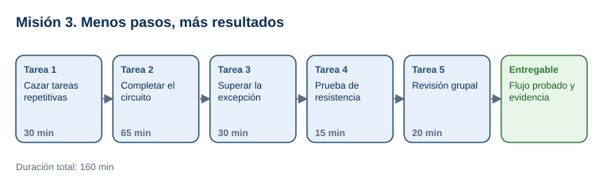

# Práctica 3. Misión 3. Menos pasos, más resultados: automatización

**Misión 3 de 3 · Herramienta: Power Automate con conectores estándar · Puntuación: 100 puntos por equipo**

⏱️ **Duración:** 2 h 40 min (160 min) · 👥 **Modalidad:** equipos de 3 · 📄 **Entregable:** `Bitacora_Mision3_[EQUIPO].docx`, flujo `Registro de solicitudes del cierre - Equipo [N]` y `Casos_Prueba_Flujo_[EQUIPO].xlsx`

## Descripción

En la jornada de la Misión 1, la Coordinación de Servicios Integrales del Centro (SIC) dedicó 90 minutos a capturar a mano 8 solicitudes y otros 60 a volver a capturarlas para avisar a cada área. Su equipo mapeará esa tarea repetitiva y adaptará un flujo base de Power Automate preparado por el instructor. El flujo registrará cada respuesta del formulario de la Misión 2 en una lista de SharePoint, publicará un aviso en el canal del equipo y, si el monto es de 50,000 MXN o más, enviará además un correo a la Coordinación. Al final, el equipo lo probará con 4 casos y comparará los pasos manuales antes y después. No se construye un flujo desde cero.

## Objetivos de aprendizaje

Al finalizar la misión, el equipo será capaz de:

- Mapear una tarea repetitiva con sus entradas, pasos, responsables, desencadenador y resultado esperado.
- Adaptar un flujo de Power Automate con conectores estándar para registrar información y enviar un aviso automático.
- Incorporar una condición con una notificación alternativa y corregir un error de configuración.
- Validar el flujo con casos de prueba y cuantificar los pasos y minutos manuales eliminados.



## Antes de empezar

| Elemento | Valor |
|---|---|
| Dónde trabajar | [make.powerautomate.com](https://make.powerautomate.com/), el formulario de la Misión 2 y el sitio de SharePoint del equipo |
| Preparado por el instructor | La lista `Registro de solicitudes` en el sitio del equipo y el flujo base `Registro de solicitudes del cierre`, compartido con el equipo como copropietario (ver [Setup_Guide.md](../Setup_Guide.md)) |
| Archivos de la misión | [Especificacion_Flujo_Base.docx](recursos/Especificacion_Flujo_Base.docx), [Casos_Prueba_Flujo.xlsx](recursos/Casos_Prueba_Flujo.xlsx), [Bitacora_Mision3.docx](recursos/Bitacora_Mision3.docx), [Rubrica_Mision3.xlsx](recursos/Rubrica_Mision3.xlsx) |
| Conectores autorizados | Microsoft Forms, SharePoint, Microsoft Teams y Office 365 Outlook (todos estándar) |
| Regla de negocio | Monto **mayor o igual a 50,000 MXN**: aviso en el canal **y** correo a la Coordinación. Monto menor: solo el aviso en el canal |
| Entregables | `Bitacora_Mision3_[EQUIPO].docx`, flujo `Registro de solicitudes del cierre - Equipo [N]` y `Casos_Prueba_Flujo_[EQUIPO].xlsx` |

> Los roles (Coordinación, Ejecución y Verificación) se rotan en cada actividad y se registran en la hoja `Roles` de `Rubrica_Mision3.xlsx`. La persona en **Ejecución** edita el flujo compartiendo pantalla; las otras dos preparan las pruebas y verifican. Todos los datos son ficticios.

**Preparación (2 min).** Cargar los 4 archivos de la misión en **Archivos** del canal **General**.

---

## Tarea 1. Actividad 1. Cazar tareas repetitivas (30 min)

**Objetivo:** Tener la hoja `Mapa_proceso` con los pasos manuales actuales para atender una solicitud, sus responsables, los minutos por paso y lo que hará el flujo, y el desencadenador y el resultado esperado escritos en la bitácora.

**Por qué:** Automatizar sin mapear solo traslada el desorden al flujo. El mapa también da el "antes" para medir la mejora en la Tarea 4.

**Paso 1.** Rotar los roles y registrarlos en la hoja `Roles` (Actividad 1).

**Paso 2.** Leer `Especificacion_Flujo_Base.docx` en equipo e identificar:

- Qué hace ya el flujo base: **Cuando se envía una respuesta nueva** > **Obtener los detalles de la respuesta** > **Crear elemento**.
- Qué debe agregar el equipo: el aviso automático (Actividad 2) y la condición de monto (Actividad 3).

**Paso 3.** Abrir `Casos_Prueba_Flujo.xlsx` > hoja `Mapa_proceso` y describir en las columnas **Antes (manual)**, **Responsable** y **Minutos** cómo se atiende hoy **una** solicitud que llega por correo. Las dos primeras filas sirven de ejemplo:

| Paso | Antes (manual) | Responsable | Minutos | Después (automatizado) |
|---|---|---|---|---|
| 1 | Abrir el correo y localizar la solicitud | Coordinación | 2 | El formulario entrega la respuesta; no hay correo |
| 2 | Copiar 6 datos a la hoja de registro | Coordinación | 5 | **Crear elemento** registra los datos en la lista |
| 3 | ... | ... | ... | ... |

- **Pista:** piense en los eventos de las 11:00 y las 15:00 del `Caso_Jornada_Operativa.docx` de la Misión 1: revisar si faltan datos, pedirlos, guardar, escribir el aviso al área y reenviar a la Coordinación los montos altos.
- **Qué verás:** el total en la celda `D9` (fórmula ya incluida). Una solicitud suele requerir de 14 a 18 minutos manuales.

**Paso 4.** Multiplicar el total por las 8 solicitudes del caso y escribir el resultado en la bitácora, sección **Actividad 1**.

**Paso 5.** Escribir en la bitácora:

- **Tarea elegida:** registro y aviso de solicitudes de pago del cierre.
- **Entradas:** las 6 preguntas del formulario (Tipo, Beneficiario, Factura, Monto MXN, Fecha requerida y Área).
- **Desencadenador:** *Cuando se envía una respuesta nueva* en `Solicitudes del cierre - Equipo [N]`.
- **Resultado esperado:** un elemento en `Registro de solicitudes`, un aviso en el canal `Cierre octubre` y, si el monto es ≥ 50,000, un correo a la Coordinación.

**Al terminar esta tarea debes tener:**

- ✔ La hoja `Mapa_proceso` con 5 a 7 pasos, el total de minutos por solicitud y la columna **Después** llena.
- ✔ El desencadenador, las entradas y el resultado esperado en la bitácora.

---

## Tarea 2. Actividad 2. Completar el circuito (65 min)

**Objetivo:** Tener la copia del flujo conectada al formulario y a la lista del equipo, con una acción que publique un aviso en el canal `Cierre octubre`, activada y probada con el caso CP-3.

**Por qué:** El flujo base solo registra. El valor para el área está en que el aviso llegue sin que nadie lo escriba.

**Paso 1.** Rotar los roles y registrarlos en la hoja `Roles` (Actividad 2).

**Paso 2.** La persona en **Ejecución** abre [make.powerautomate.com](https://make.powerautomate.com/) con su cuenta institucional y selecciona **Mis flujos** > **Compartido conmigo**.

- **Qué verás:** el flujo `Registro de solicitudes del cierre` con el instructor como propietario.
- **Si no ocurre así:** avisar al instructor para que agregue al equipo como copropietario.

**Paso 3.** Seleccionar los **...** del flujo > **Guardar como**. Escribir el nombre `Registro de solicitudes del cierre - Equipo [N]` y seleccionar **Guardar**.

- **Qué verás:** la copia aparece en **Mis flujos** > **Flujos de nube** con el estado **Desactivado**. Es normal: las copias se crean desactivadas.

**Paso 4.** Abrir la copia y seleccionar **Editar**.

- **Qué verás:** el diseñador con 3 tarjetas en vertical: el desencadenador de Forms, **Obtener los detalles de la respuesta** y **Crear elemento**.
- **Si no ocurre así:** si aparece **Corregir conexiones** o un triángulo de advertencia en una tarjeta, seleccionar la tarjeta > **Cambiar la conexión** > **Agregar nueva** e iniciar sesión con la cuenta institucional. Las conexiones del flujo base son del instructor.

**Paso 5.** Conectar el flujo al formulario del equipo:

- Seleccionar la tarjeta **Cuando se envía una respuesta nueva** > **Id. del formulario** > elegir `Solicitudes del cierre - Equipo [N]`.
- Seleccionar **Obtener los detalles de la respuesta** > **Id. del formulario** > el mismo formulario. En **Id. de respuesta** debe estar el contenido dinámico **Id. de respuesta**.

**Paso 6.** Conectar el flujo a la lista del equipo. Seleccionar **Crear elemento**:

- **Dirección del sitio:** el sitio `Cierre Octubre - Equipo [N]`.
- **Nombre de la lista:** `Registro de solicitudes`.
- Asignar cada columna con el contenido dinámico (icono de rayo ⚡ > **Obtener los detalles de la respuesta**):

| Columna de la lista | Contenido dinámico (pregunta del formulario) |
|---|---|
| Beneficiario (Título) | Beneficiario |
| Tipo Value | Tipo |
| Factura | Factura |
| Monto_MXN | Monto MXN |
| Fecha_requerida | Fecha requerida |
| Area Value | Área |
| Estado Value | Escribir `Recibida` |

- **Si no ocurre así:** si un campo muestra la pregunta del formulario del instructor, borrarlo y volver a seleccionarlo desde el formulario del equipo.

**Paso 7.** Agregar el aviso. Debajo de **Crear elemento**, seleccionar **+** > **Agregar una acción**, buscar `Publicar mensaje en un chat o canal` (Microsoft Teams) y seleccionarla. Configurar:

- **Publicar como:** `Flow bot`
- **Publicar en:** `Canal`
- **Team:** `Cierre Octubre - Equipo [N]`
- **Channel:** `Cierre octubre`
- **Message:** escribir el texto y, en cada corchete, insertar el contenido dinámico indicado:

```text
Nueva solicitud registrada. Folio: [ID de Crear elemento]
Tipo: [Tipo] · Beneficiario: [Beneficiario] · Factura: [Factura]
Monto: [Monto MXN] MXN · Fecha requerida: [Fecha requerida] · Área: [Área]
```

- **Alternativa:** si Teams no está disponible, usar **Enviar un correo electrónico (V2)** (Office 365 Outlook), con **Para** el correo de un integrante, asunto `Nueva solicitud registrada` y el mismo texto en el cuerpo.

**Paso 8.** Seleccionar **Guardar** (arriba a la derecha) y después **Comprobador de flujo**.

- **Qué verás:** el mensaje **El flujo está listo** o una lista de errores y advertencias.
- **Si no ocurre así:** seleccionar cada error para ir a la tarjeta que lo tiene. El error más común es un campo obligatorio vacío en **Crear elemento**.

**Paso 9.** Volver a la página del flujo y seleccionar **Activar**. Abrir de nuevo **Editar** > **Probar** > **Manualmente** > **Probar**.

**Paso 10.** Otro integrante abre el formulario y envía el caso **CP-3** de la hoja `Casos_de_prueba`: Pago a proveedor · Papelería del Valle · F-7710 · `12480` · 04/11/2026 · Contabilidad.

- **Qué verás:** en 10 a 60 segundos, las 4 tarjetas con una marca verde ✔ en el diseñador, un elemento nuevo en `Registro de solicitudes` con el estado `Recibida` y el aviso del Flow bot en el canal `Cierre octubre`.
- **Si no ocurre así:** seleccionar la tarjeta con la marca roja ✖ y leer **Mostrar detalles**. Anotar el error y su corrección en la bitácora.

**Paso 11.** Completar en la bitácora la sección **Actividad 2**: la acción agregada y el resultado de la primera prueba.

**Al terminar esta tarea debes tener:**

- ✔ El flujo `Registro de solicitudes del cierre - Equipo [N]` activado y conectado al formulario y la lista del equipo.
- ✔ Una ejecución correcta de CP-3: el elemento en la lista y el aviso en el canal.

---

## Tarea 3. Actividad 3. Superar la excepción (30 min)

**Objetivo:** Tener una condición que envíe además un correo a la Coordinación cuando el monto sea mayor o igual a 50,000 MXN, probada en sus dos ramas y con el error de tipo de dato corregido.

**Por qué:** Los montos altos requieren la atención de la Coordinación (en el caso, la solicitud de TecnoRed por 56,900). El flujo debe distinguirlos sin intervención humana.

**Paso 1.** Rotar los roles y registrarlos en la hoja `Roles` (Actividad 3).

**Paso 2.** En **Editar**, debajo de la acción de Teams, seleccionar **+** > **Agregar una acción**, buscar `Condición` (Control) y seleccionarla. Configurar la primera fila:

- **Valor de la izquierda:** contenido dinámico **Monto MXN**.
- **Operador:** **es mayor o igual que**.
- **Valor de la derecha:** `50000`.
- **Qué verás:** la tarjeta **Condición** con dos ramas: **Verdadero** y **Falso**.

**Paso 3.** En la rama **Verdadero**, seleccionar **+** > **Agregar una acción** > **Enviar un correo electrónico (V2)** (Office 365 Outlook) y configurar:

- **Para:** el correo del integrante en el rol de Coordinación.
- **Asunto:** `Solicitud de monto alto: ` + contenido dinámico **Beneficiario**.
- **Cuerpo:** `Se registró una solicitud de ` + **Monto MXN** + ` MXN de ` + **Beneficiario** + `. Folio: ` + **ID** (de **Crear elemento**) + `. Requiere revisión de la Coordinación.`

Dejar la rama **Falso** sin acciones: el aviso del canal ya se envió antes de la condición.

**Paso 4.** Guardar, seleccionar **Probar** > **Manualmente** y enviar desde el formulario el caso **CP-1**: Pago a proveedor · TecnoRed SA · F-4410 · `56900` · 05/11/2026 · Coordinación.

- **Qué verás:** lo más probable es que la tarjeta **Condición** falle con un mensaje parecido a *"…cannot be evaluated because…"* o que el flujo tome la rama equivocada. **Este es el error de configuración que hay que corregir.**
- **Por qué ocurre:** Forms entrega todas las respuestas como **texto**, aunque la pregunta tenga la restricción Número, y no se puede comparar el texto `"56900"` con el número `50000`.

**Paso 5.** Corregir el error. En la **Condición**, borrar **Monto MXN** del valor de la izquierda, seleccionar el icono **fx** (Insertar expresión) y escribir `float()`. Con el cursor dentro de los paréntesis, seleccionar la pestaña **Contenido dinámico** > **Monto MXN** y seleccionar **Agregar**.

- **Qué verás:** el valor de la izquierda muestra `float(...)` en un recuadro de expresión.
- **Si no ocurre así:** si la prueba de CP-1 no falló en el paso 4, aplicar de todos modos la corrección y anotar en la bitácora *"Sin error en este tenant; se aplicó float() como prevención"*.

**Paso 6.** Guardar y probar de nuevo con **CP-1**. Después probar con **CP-2**: Reembolso de gastos · Mario Soto · F-1203 · `640.50` · 06/11/2026 · Tesorería.

- **Qué verás:** CP-1 toma la rama **Verdadero** y llega el correo a la Coordinación. CP-2 toma la rama **Falso** y no llega el correo. Ambos crean el elemento y publican el aviso.

**Paso 7.** Completar en la bitácora la sección **Actividad 3**: la condición configurada, la rama alternativa probada y el error corregido.

**Al terminar esta tarea debes tener:**

- ✔ La condición con `float(Monto MXN)` mayor o igual a `50000`.
- ✔ CP-1 con correo a la Coordinación y CP-2 sin correo, ambos correctos.

---

## Tarea 4. Actividad 4. Prueba de resistencia (15 min)

**Objetivo:** Tener los 4 casos de prueba ejecutados con su resultado anotado, una captura del historial de ejecuciones y la comparación de minutos antes y después.

**Por qué:** El caso límite (exactamente 50,000) es donde más fallan las condiciones: un error de "mayor que" por "mayor o igual que" cambia el resultado.

**Paso 1.** Rotar los roles y registrarlos en la hoja `Roles` (Actividad 4).

**Paso 2.** Enviar desde el formulario el caso **CP-4**: Anticipo · Luis Vega · N/A · `50000` · 06/11/2026 · Compras.

- **Qué verás:** el correo a la Coordinación (50,000 es "mayor o igual que" 50,000).
- **Si no ocurre así:** revisar que el operador sea **es mayor o igual que** y no **es mayor que**.

**Paso 3.** En la hoja `Casos_de_prueba`, llenar **Resultado obtenido** y **¿Correcto? (Sí/No)** para CP-1, CP-2, CP-3 y CP-4.

**Paso 4.** En la página del flujo, revisar **Historial de ejecuciones de 28 días**. Tomar una captura de pantalla con las ejecuciones correctas (**Windows + Shift + S**) y pegarla en la bitácora, sección **Actividad 4**.

**Paso 5.** En la hoja `Mapa_proceso`, escribir en una celda libre los minutos que siguen siendo manuales después de automatizar (por ejemplo, revisar el correo de monto alto: 2 minutos). Escribir en la bitácora: pasos manuales antes y después, y minutos ahorrados por solicitud y para las 8 solicitudes del caso.

**Paso 6.** Guardar el archivo como `Casos_Prueba_Flujo_[EQUIPO].xlsx` (**Archivo** > **Guardar como** > **Cambiar nombre**).

**Al terminar esta tarea debes tener:**

- ✔ 4 casos con resultado y la columna **¿Correcto?** en **Sí**.
- ✔ La captura del historial en la bitácora y los minutos antes y después.

---

## Tarea 5. Revisión grupal de la misión (20 min)

**Objetivo:** Demostrar el flujo con un caso nuevo, resolver con el grupo las incidencias frecuentes y recibir la puntuación.

**Por qué:** Revisar las incidencias de todos los equipos prepara al grupo para mantener flujos reales en su área.

**Paso 1.** Cada equipo demuestra en 3 minutos, compartiendo pantalla: el instructor dicta un caso nuevo (por ejemplo, *Viáticos · Julia Cruz · N/A · 75000 · Planeación*), el equipo lo envía desde el formulario y muestra el elemento en la lista, el aviso en el canal y el correo de monto alto.

**Paso 2.** El instructor revisa con el grupo las incidencias frecuentes y cómo se resolvieron:

| Incidencia | Solución |
|---|---|
| **Corregir conexiones** al abrir la copia | Agregar conexiones propias en cada tarjeta |
| El flujo no se ejecuta | La copia estaba **Desactivada** |
| La condición falla o toma la rama equivocada | Usar `float()` con el monto |
| El aviso llega a otro canal | Revisar **Team** y **Channel** en la acción de Teams |
| CP-4 no envía el correo | Operador **es mayor que** en lugar de **es mayor o igual que** |

**Paso 3.** El instructor registra la puntuación en `Rubrica_Mision3.xlsx`. El equipo guarda la bitácora como `Bitacora_Mision3_[EQUIPO].docx` y la mueve, junto con `Casos_Prueba_Flujo_[EQUIPO].xlsx`, a **Archivos** del canal `Cierre octubre`.

**Al terminar esta tarea debes tener:**

- ✔ El caso nuevo procesado correctamente en vivo.
- ✔ La puntuación registrada y los entregables en el canal `Cierre octubre`.

---

## Validación y pruebas

| Caso | Entrada | Resultado esperado |
|---|---|---|
| CP-1 | 56,900 MXN · Coordinación | Elemento creado, aviso en el canal y correo a la Coordinación |
| CP-2 | 640.50 MXN · Tesorería | Elemento creado y aviso en el canal; sin correo |
| CP-3 | 12,480 MXN · Contabilidad | Elemento creado y aviso en el canal; sin correo |
| CP-4 (límite) | 50,000 MXN · Compras | Elemento creado, aviso y correo a la Coordinación |
| Caso adversarial | Pregunta del instructor: *"¿Agregamos un conector premium para mandar un SMS a Dirección?"* | No: solo se usan los conectores estándar autorizados |

## Entregables

| Entregable | Contenido | Criterio de verificación |
|---|---|---|
| Flujo `Registro de solicitudes del cierre - Equipo [N]` | Registro en la lista, aviso en el canal y condición de monto alto | Activado; 4 ejecuciones correctas en el historial |
| `Casos_Prueba_Flujo_[EQUIPO].xlsx` | Hojas `Casos_de_prueba` y `Mapa_proceso` | 4 casos con resultado; minutos antes y después |
| `Bitacora_Mision3_[EQUIPO].docx` | Las 4 actividades | Desencadenador, acción agregada, condición, error corregido, captura del historial y minutos ahorrados |
| `Rubrica_Mision3.xlsx` | Hoja `Roles` y puntuación | Llenada por el instructor |

## Resultado esperado

- El equipo adapta y prueba una automatización con conectores estándar que elimina la captura y el aviso manual de cada solicitud.
- El equipo explica la mejora con datos: pasos y minutos antes y después.

## Solución de problemas

**El flujo no se ejecuta al enviar el formulario**
- *Síntoma:* el historial de ejecuciones está vacío.
- *Causa:* la copia está desactivada o el desencadenador apunta al formulario del instructor.
- *Solución:* seleccionar **Activar** en la página del flujo y revisar el **Id. del formulario** del desencadenador.

**Crear elemento falla con un error de columna**
- *Síntoma:* ✖ en **Crear elemento** con un mensaje sobre `Monto_MXN` o una columna de elección.
- *Causa:* un valor no coincide con el tipo de la columna (por ejemplo, un área que no existe en la lista de opciones).
- *Solución:* revisar que las opciones de **Área** y **Tipo** del formulario sean iguales a las de la lista; para el monto, usar `float()` como en la Tarea 3.

**La acción de Teams no muestra el canal**
- *Síntoma:* la lista **Channel** está vacía.
- *Causa:* la conexión de Teams es de una cuenta que no es miembro del equipo.
- *Solución:* cambiar la conexión a la de un integrante o usar la alternativa de correo.

## Limpieza

- Al terminar el taller, si el flujo no se seguirá usando, seleccionar **Desactivar** en la página del flujo.

## Recursos opcionales

- [Power Automate con Microsoft Forms](https://learn.microsoft.com/es-es/power-automate/forms/overview)
- [Conectores estándar](https://learn.microsoft.com/es-es/connectors/connector-reference/connector-reference-standard-connectors)

<sub>Complejidad: Intermedia · Nivel de Bloom: Crear</sub>

---

[⬅ Anterior: Misión 2](../Capitulo02/README.md) | [Inicio](../README.md)
