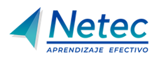

# Talleres Aplicados de Productividad Digital con Microsoft 365 - Misiones colaborativas

## Plataforma de laboratorios

Te damos la bienvenida a la **plataforma de laboratorios** del taller **Talleres Aplicados de Productividad Digital con Microsoft 365 - Misiones colaborativas**. Aquí podrás explorar diferentes tecnologías a través de prácticas guiadas. ¡Desarrolla tus habilidades y lleva tus conocimientos al siguiente nivel!

## Descripción del curso

Taller gamificado de 8 horas, 100% práctico, organizado en tres misiones colaborativas sobre un caso operativo transversal. Los participantes trabajan preferentemente en equipos de tres y usan Microsoft 365 para coordinar tareas, organizar información y automatizar procesos. Los últimos 20 minutos de cada misión se dedican a revisión, corrección y retroalimentación grupal. Se otorga una puntuación por equipo y misión, sin calificar actividades individuales.

## Objetivos del curso

Aplicar los conocimientos previos en tres retos colaborativos: organizar el trabajo con Teams y Planner, gestionar documentos y capturar datos con SharePoint y Forms, y adaptar una automatización básica con Power Automate. Comprobar soluciones mediante pruebas guiadas, corregir errores y explicar mejoras operativas.

## Perfil de audiencia

Personal operativo con formación previa o conocimientos equivalentes de productividad digital en Microsoft 365, que necesite resolver procesos de gestión, seguimiento e información institucional mediante trabajo colaborativo.

## Prerrequisitos

- Haber cursado la formación virtual *Productividad Digital con Microsoft 365* o demostrar conocimientos equivalentes.
- Contar con acceso autorizado a Microsoft 365 (Teams, SharePoint, Forms, Planner, Excel, Power Automate con conectores estándar y Copilot Chat básico).
- El instructor prepara con antelación los datos, archivos, espacios de práctica y el flujo base, según la [Guía de configuración](Setup_Guide.md).

## El caso y la dinámica

Las tres misiones ocurren en la Coordinación Administrativa y Financiera de **Servicios Integrales del Centro (SIC)**, organización ficticia que debe cerrar el mes de octubre de 2026 (conciliación bancaria al 4 de noviembre, informe a Dirección el 10 y comité el 11).

- **Equipos:** 3 integrantes, preferentemente.
- **Roles rotativos:** Coordinación, Ejecución y Verificación; se rotan en cada actividad.
- **Puntuación:** una sola por equipo al final de cada misión (máximo 100 puntos): funcionamiento (40), uso adecuado de herramientas (25), calidad y validación (20) y colaboración y explicación (15). Máximo total: **300 puntos por equipo**. No se califican las actividades por separado.

## Lista de laboratorios

Cada uno de estos laboratorios está diseñado para ofrecerte una experiencia práctica. Haz clic en los enlaces para comenzar.

### [Práctica 1. Misión 1. Operación coordinada: rescatar una jornada de trabajo](Capitulo01/README.md)

  - **Descripción**: diagnóstico de una jornada operativa, tablero de rescate en Planner, canal de coordinación en Teams y mensaje de acción elaborado con Copilot Chat básico.
  - ⏱️ **Duración estimada**: 160 min (2 h 40 min) · 100 puntos.

### [Práctica 2. Misión 2. Expediente confiable: información sin pérdidas](Capitulo02/README.md)

  - **Descripción**: repositorio de SharePoint con nomenclatura, metadatos, vistas y versiones; formulario de Forms sin omisiones y depuración de respuestas para Excel o Power BI.
  - ⏱️ **Duración estimada**: 160 min (2 h 40 min) · 100 puntos.

### [Práctica 3. Misión 3. Menos pasos, más resultados: automatización](Capitulo03/README.md)

  - **Descripción**: mapeo de una tarea repetitiva y adaptación de un flujo base de Power Automate con seguimiento automático, condición y casos de prueba.
  - ⏱️ **Duración estimada**: 160 min (2 h 40 min) · 100 puntos.

### Distribución del tiempo

| Misión | Actividades | Revisión grupal | Total |
|---|---|---|---|
| 1. Operación coordinada | 30 + 40 + 45 + 25 = 140 min | 20 min | 160 min |
| 2. Expediente confiable | 40 + 40 + 35 + 25 = 140 min | 20 min | 160 min |
| 3. Menos pasos, más resultados | 30 + 65 + 30 + 15 = 140 min | 20 min | 160 min |
| **Total** | **420 min** | **60 min** | **480 min (8 h, 100% práctica)** |

## Instrucciones generales del laboratorio

1. Antes del taller, el instructor prepara los equipos de Teams, los archivos y el flujo base con la [Guía de configuración](Setup_Guide.md).
2. Cada misión está en su carpeta `CapituloNN` con su `README.md` y la carpeta `recursos`. Para descargar un archivo, abrirlo y seleccionar **Download raw file**.
3. Cada equipo trabaja en su equipo de Teams `Cierre Octubre - Equipo [N]` y guarda los entregables en **Archivos** del canal `Cierre octubre`, con el número de equipo en el nombre (`[EQUIPO]`).
4. Las misiones son progresivas: el canal y el plan de la Misión 1 y la biblioteca y el formulario de la Misión 2 se reutilizan después.
5. Registrar los roles de cada actividad en la hoja `Roles` de la rúbrica de la misión.
6. Usar Copilot Chat básico solo con la cuenta institucional y solo con la información del caso; verificar siempre su respuesta.
7. Todos los datos son ficticios. No cargar información real de la organización.

## Estructura del repositorio

```text
.
├── README.md            Página principal (este archivo)
├── Setup_Guide.md       Guía de configuración del entorno
├── images/              Logotipo y diagramas de las misiones
├── Capitulo01/          Misión 1: README.md y recursos/
├── Capitulo02/          Misión 2: README.md y recursos/
└── Capitulo03/          Misión 3: README.md y recursos/
```

## Recursos adicionales

- [Microsoft 365 Copilot Chat](https://learn.microsoft.com/es-es/copilot/overview)
- [Equipos y canales en Microsoft Teams](https://learn.microsoft.com/es-es/microsoftteams/teams-channels-overview)
- [Ayuda de Microsoft Planner](https://support.microsoft.com/es-es/planner)

## Enlaces de referencia

- [Crear un formulario con Microsoft Forms](https://support.microsoft.com/es-es/office/crear-un-formulario-con-microsoft-forms-4ffb64cc-7d5d-402f-b82e-b1d49418fd9d)
- [Control de versiones en SharePoint](https://support.microsoft.com/es-es/office/habilitar-y-configurar-el-control-de-versiones-de-una-lista-o-biblioteca-1555d642-23ee-446a-990a-bcab618c7a37)
- [Power Automate con Microsoft Forms](https://learn.microsoft.com/es-es/power-automate/forms/overview)
- [Conectores estándar de Power Platform](https://learn.microsoft.com/es-es/connectors/connector-reference/connector-reference-standard-connectors)

---

## 📬 **Contacto y más información**

Si tienes alguna pregunta o necesitas más detalles, no dudes en [contactarnos](mailto:soporte@netec.com). También puedes encontrar más recursos en nuestra [página](https://netec.com).

---

¡Gracias por visitar nuestra plataforma! No olvides revisar todos los laboratorios y comenzar tu viaje de aprendizaje hoy mismo.
